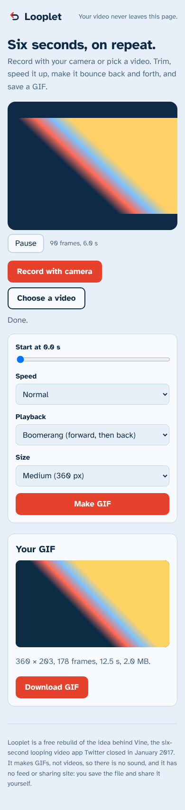

# Looplet

Turn a short video, or a clip from your camera, into a looping GIF. Pick which six seconds, speed it up or slow it down, make it bounce back and forth, and save the file. Everything happens in your browser: no upload, no account, no server.

A student rebuild of the idea behind **Vine**, the six-second looping video app that Twitter closed in January 2017. Vine was a camera, a loop and a feed. Looplet keeps the camera and the loop and drops the feed, because a feed needs a server, moderation and money. You save the GIF and share it wherever you like.

**Live demo:** https://jay-m007.github.io/looplet/ (once published)



## What it does

- **Two sources**: record up to six seconds with the camera (3-2-1 countdown, stop early if you like), or choose a video file.
- **Pick the part**: for a long video, a slider chooses where the six seconds start.
- **Shape it**: speed (half, normal, 1.5x, double), loop or boomerang, and size (240, 360 or 480 pixels on the long side).
- **Real GIF out**: a looping GIF written by a small encoder in this repo (median-cut palette, LZW compression). The result is shown on the page and downloads as `looplet.gif`.

## Run it

```
npm test          # 15 tests, plain Node, no packages
npm run serve     # builds site/ and serves http://localhost:8080
```

No dependencies, no bundler. The page imports the same `engine/` files the tests run.

## How it is built

```
engine/gif.js      palette (median cut), indexer, LZW, GIF writer
engine/frames.js   frame times, sizes, ping-pong order, delays
web/               index.html, style.css, app.js (no framework)
tests/             encoder checked by an independent reader written from the GIF spec
```

- **Privacy by construction**: a Content Security Policy with `connect-src 'none'` and no outside files, so the browser itself blocks any upload. The camera stream is never recorded anywhere except as pixels in memory.
- **Video is read frame by frame**: the page seeks a hidden video element to each time and copies the picture to a canvas, 15 frames per second.
- **The encoder was checked three ways**: my own tests with a separate GIF reader, Pillow (a widely used image library) opening the output, and the browser showing the GIF back inside the page.

## Honest limits

- **GIF, not video.** No sound, 256 colours, and files can be large: a six-second clip at 360 px is often 0.5 to 2 MB, more for busy footage. If it is too big for a chat app, choose Small or a faster speed.
- **No feed, no sharing site.** Vine's community was the point; this does not try to be one.
- **Which videos open depends on your browser.** MP4 (H.264) and WebM usually work. If the browser cannot decode a file, the page says so; it does not convert formats.
- **Camera needs a secure page** (https or localhost) and your permission. Tested with a fake camera in an automated browser, not on a range of real phones.
- **Phones may be slow** on big files because the work runs on the page. Reading and encoding show progress.
- **Palette is shared by the whole clip**, so clips with big colour changes look a little rough. There is no dithering.
- Not tested with real users.

## Licence

MIT. See `LICENSE`.
